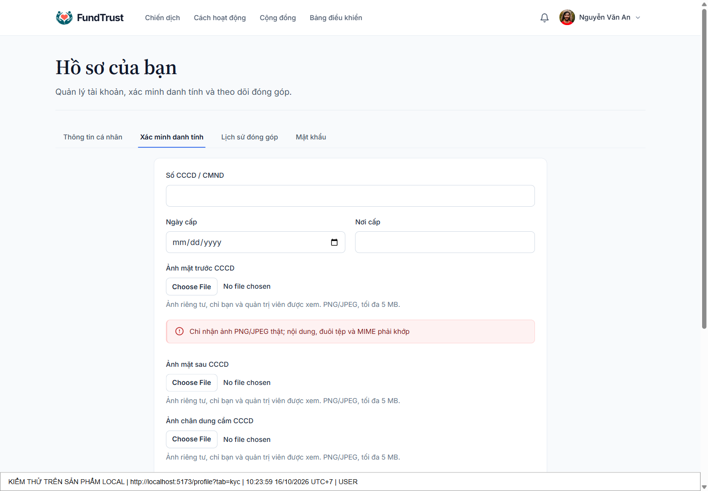
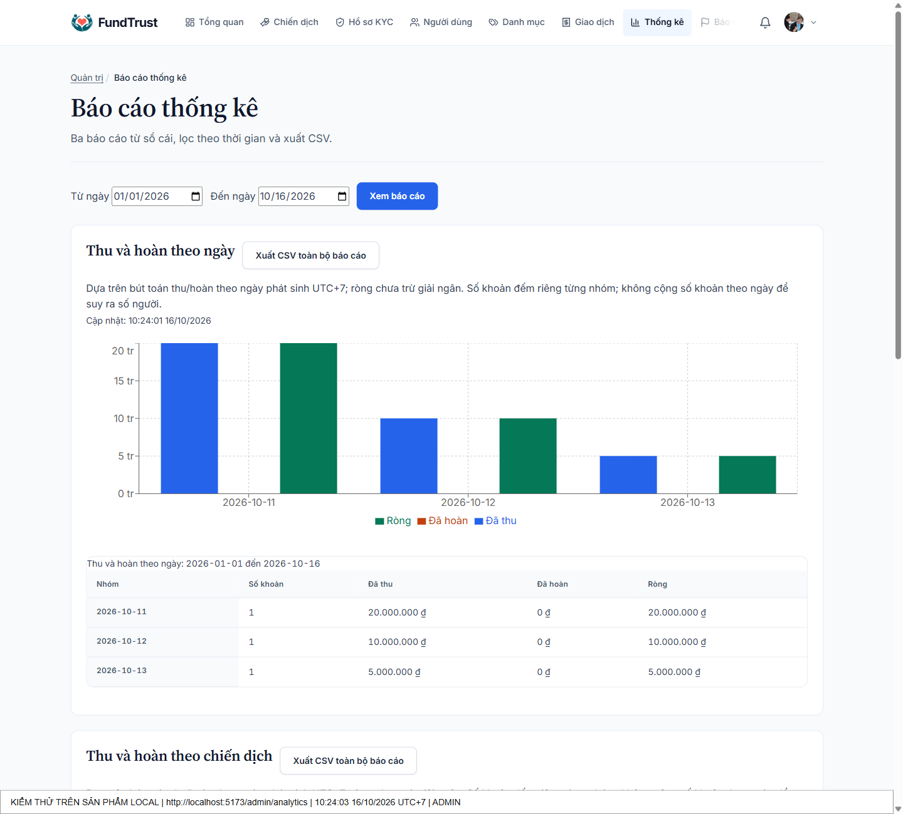
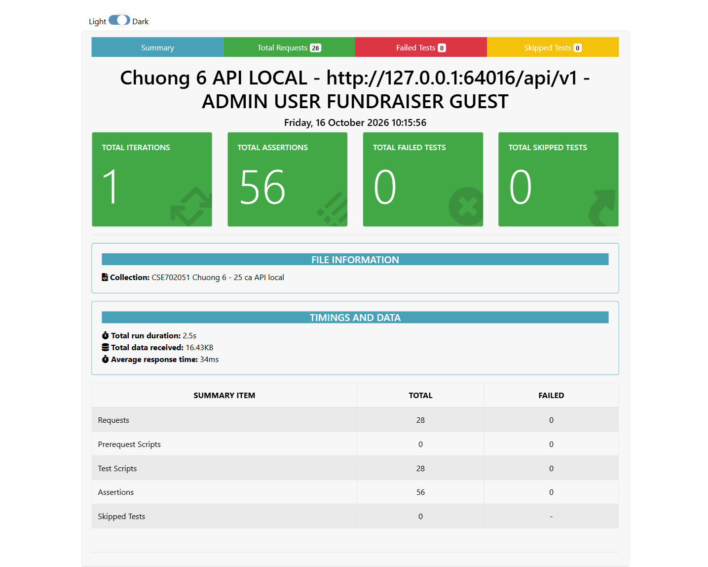
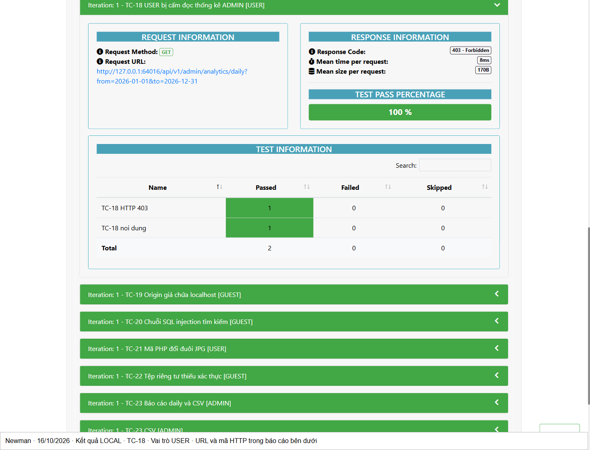
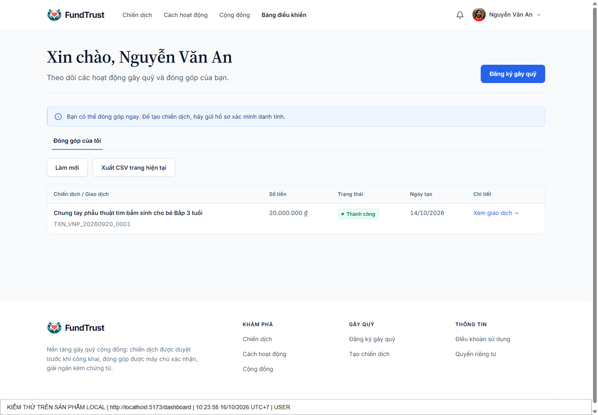
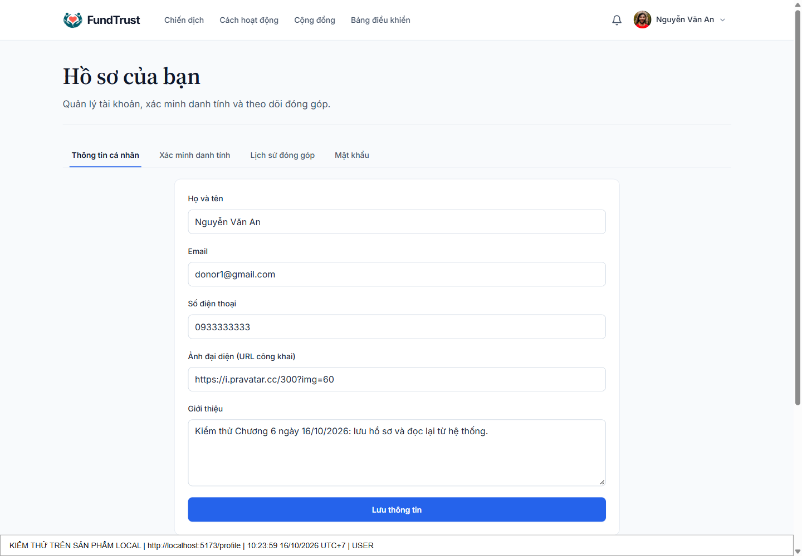
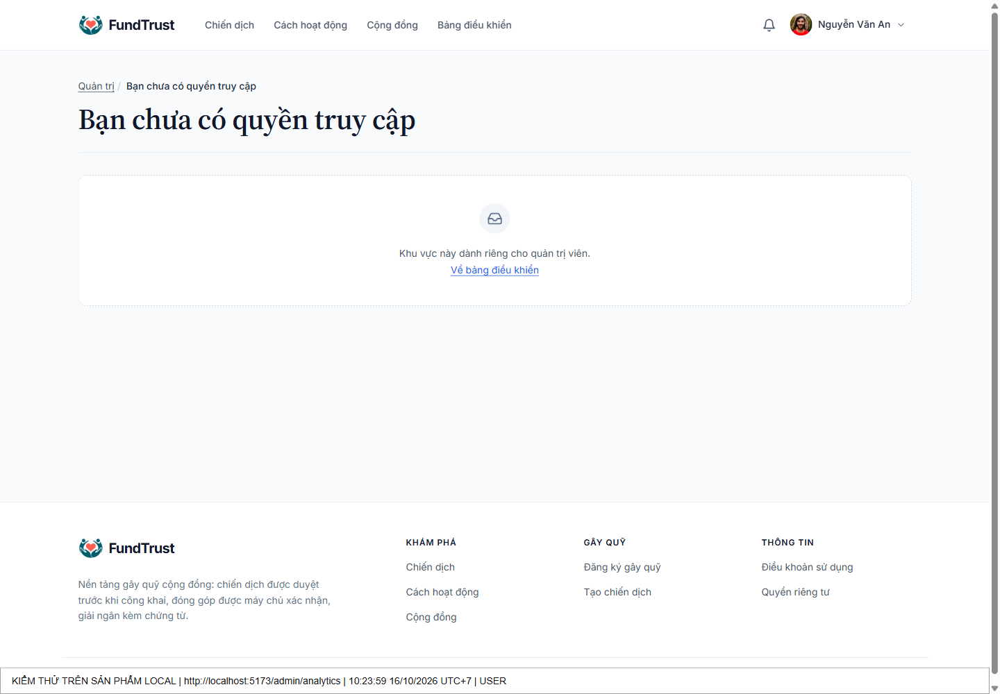
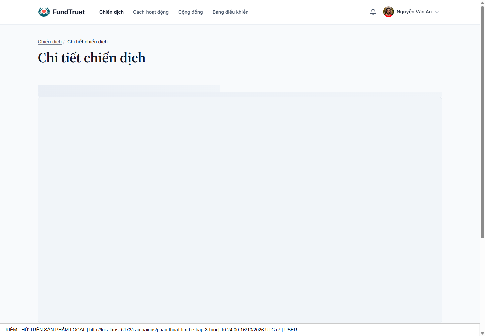

# CHƯƠNG 6. KIỂM THỬ VÀ ĐÁNH GIÁ KẾT QUẢ

Chương này đánh giá hệ thống gây quỹ cộng đồng FundTrust thông qua kiểm thử đơn vị, tích hợp, API và thao tác trên giao diện. Đợt kiểm tra ngày 16/10/2026 được thực hiện trên phiên bản mã nguồn 95d9b7c sau khi đồng bộ nhánh main. Kết quả xác nhận các kịch bản đã thực hiện ở môi trường cục bộ; chưa thay thế nghiệm thu hệ thống trực tuyến hoặc chứng minh mọi yêu cầu chức năng đều hoàn thành.

## 6.1. Chiến lược kiểm thử, môi trường kiểm thử và dữ liệu kiểm thử

### 6.1.1. Chiến lược và tiêu chí đánh giá

Nhóm áp dụng kiểm thử theo rủi ro, ưu tiên xác thực và phân quyền, tính toàn vẹn các khoản đóng góp, chống hoàn tiền lặp, kiểm soát tệp và tính đúng của báo cáo. Kiểm thử hộp đen đối chiếu phản hồi với kết quả mong đợi; kiểm thử hộp trắng kiểm tra quy tắc nghiệp vụ, hàm xử lý dữ liệu và các nhánh từ chối. Với dữ liệu tài chính, kết quả HTTP được đối chiếu thêm với bản ghi MySQL, bút toán, số dư, nhật ký và thông báo.

Một ca được kết luận đạt khi tất cả xác nhận của ca đều đúng. Mã 400, 401, 403, 409, 415 hoặc 422 là kết quả đạt nếu ca cố ý gửi dữ liệu sai hoặc yêu cầu không đủ quyền. Tỷ lệ đạt được tính riêng cho từng bộ kiểm thử, không cộng lẫn số ca, số yêu cầu HTTP và số xác nhận. Kết quả không chạy được hoặc thiếu bằng chứng không được ghi là đạt.

Bảng 6.1. Các lớp kiểm thử và phạm vi bằng chứng

| Lớp kiểm thử | Cách thực hiện | Phạm vi và giới hạn |
|---|---|---|
| Đơn vị và tích hợp thành phần | Node test runner, assert, Supertest; sáu tệp tests/*.test.ts. | Phần lớn repository/audit được thay bằng đối tượng kiểm thử; upload dùng multipart và tệp thật. Không coi toàn bộ 83 test là tích hợp MySQL. |
| Tích hợp API và CSDL | 25 ca HTTP có sẵn; collection Postman chạy bằng Newman; kiểm tra tổng thu bằng SQL độc lập. | Express, middleware và MySQL local thật. Collection gồm 25 ca, 28 yêu cầu và 56 xác nhận. |
| Tài chính và đồng thời | Bộ Buổi 6 chạy trong database chuyên dụng. | Tiền mô phỏng; kiểm tra transaction, trigger, rollback và 50 yêu cầu hoàn đồng thời. |
| Giao diện có kiểm soát | Playwright và axe, 41 ca với phản hồi API mô phỏng. | Xác nhận UI/điều hướng/hiển thị lỗi; không dùng kết quả này thay kiểm chứng nghiệp vụ trên MySQL. |
| Kiểm thử trên sản phẩm | Chrome mở cửa sổ, thao tác trên FE và BE đang chạy, không thay phản hồi mạng. | Bảy kiểm tra gồm sáu ảnh sản phẩm và một lần tải CSV; trạng thái hồ sơ được khôi phục sau thử. |

### 6.1.2. Môi trường kiểm thử

Bảng 6.2. Môi trường và phiên bản được kiểm tra

| Thành phần | Cấu hình thực tế |
|---|---|
| Thời điểm và mã nguồn | 16/10/2026, múi giờ Asia/Ho_Chi_Minh (UTC+7); main tại 95d9b7c9525194c0197aa826b35a6573486c817f. |
| Máy và runtime | Windows; PowerShell; Node.js v24.16.0; npm 11.13.0. |
| Backend và cơ sở dữ liệu | Express 5, TypeScript, Prisma 7; MySQL 8.0.46 trong Docker; Redis 7. |
| Frontend | React 18, Vite 8; Chrome; Playwright 1.64; axe-core thông qua @axe-core/playwright. |
| Địa chỉ sản phẩm | FE http://localhost:5173; API http://localhost:5000/api/v1. CLIENT_URL dùng localhost; 127.0.0.1 là origin khác trong kiểm tra CSRF. |
| Địa chỉ collection | Newman dùng cổng local do hệ điều hành cấp: http://127.0.0.1:64016/api/v1. Cổng này chỉ tồn tại trong lần chạy. |
| Công cụ API | Newman 6.2.1 chạy collection Postman 2.1; htmlextra 1.23.1 xuất báo cáo; có thể nhập collection vào Apidog. |
| Dịch vụ phụ trợ | MySQL và Redis báo healthy. MinIO báo unhealthy khi kiểm tra; luồng upload được kiểm thử ở đợt này dùng lưu trữ đĩa local, không xác nhận MinIO hoạt động. |

Trước kiểm thử, lệnh đồng bộ Git trả về Already up to date. Trong đợt này chỉ điều chỉnh việc đóng kết nối Redis/Prisma sau test và cập nhật locator, dữ liệu bắt buộc của bài test frontend cho đúng giao diện hiện tại; không sửa logic chức năng ứng dụng để thay đổi kết quả kiểm thử. Các lần lỗi ban đầu và kết quả chạy lại đều được giữ trong hồ sơ bằng chứng.

### 6.1.3. Dữ liệu và kiểm soát tác động

Database crowdfunding_local_20261014_5c44e7 có 5 tài khoản, 5 danh mục, 3 chiến dịch, 3 khoản đóng góp và 3 bút toán tại thời điểm chạy collection. Ba bút toán thu có tổng 35.000.000 VND. Đây là dữ liệu mẫu cục bộ, không phải doanh thu thực tế và không đại diện quy mô vận hành.

Ba vai trò được kiểm tra bằng tài khoản mẫu admin@crowdfunding.vn (ADMIN), fundraiser@gmail.com (FUNDRAISER), donor1@gmail.com (USER); donor2@gmail.com được dùng để kiểm tra khác chủ sở hữu. Mật khẩu, token và cookie không đưa vào ảnh hay báo cáo. Các kịch bản tài chính dùng database crowdfunding_session06_test riêng, tạo UUID mới và khoản 100.000 VND mô phỏng. Script kiểm thử có điều kiện từ chối database cloud.

Dữ liệu biên gồm email sai định dạng, ngày 30/02, trang âm, limit quá lớn, hồ sơ KYC rỗng và upload thiếu tệp. Dữ liệu đối kháng gồm JWT sai chữ ký, Origin giả, chuỗi tìm kiếm SQL injection, mã PHP mang đuôi JPG và truy cập tài nguyên của người khác. Các phản hồi 500 có chủ đích được tạo bằng fault injection ở ranh giới dịch vụ; đây không phải sự cố ngẫu nhiên khi vận hành.

## 6.2. Kiểm thử đơn vị và kiểm thử tích hợp

### 6.2.1. Danh mục kiểm thử đã thực hiện

Bảng 6.3. Kết quả bộ kiểm thử backend

| Tệp kiểm thử | Nội dung chính | Kết quả |
|---|---|---|
| activity-logs.test.ts | Nhật ký cá nhân theo danh tính token; USER/FUNDRAISER không đọc nhật ký quản trị; lọc, phân trang. | 16/16 |
| analytics.test.ts | Biên ngày UTC+7; ngày sai; CSV có dấu phẩy, nháy kép, xuống dòng và công thức bảng tính. | 2/2 |
| authorization.test.ts | Thiếu/sai/hết hạn token; refresh token; quyền KYC; chèn userId/role; băm mật khẩu và dữ liệu sai. | 35/35 |
| cache-endpoints.test.ts | Gộp bút toán, tránh N+1, cache HIT/MISS, vô hiệu cache và phân biệt khóa theo bộ lọc. | 8/8 |
| object-access.test.ts | Quyền chủ sở hữu, chiến dịch nháp, ẩn thông tin nhạy cảm, thông báo và thành viên cộng đồng. | 9/9 |
| uploads.test.ts | PNG thật, ảnh giả, sai đuôi, quá 5 MB, thiếu tệp, truy cập chủ sở hữu/ADMIN/người khác. | 12/12 ca con; 1 test cha đạt |
| Tổng theo Node test runner | 82 test lá và 1 test cha; không có fail, skip hoặc cancelled. | 83/83 |

Bộ kiểm thử ban đầu không kết thúc vì một số tệp chưa đóng Redis sau khi hoàn thành. Nhóm bổ sung teardown đóng Redis và Prisma ở ba tệp activity-logs, cache-endpoints và object-access; các xác nhận nghiệp vụ không bị nới lỏng. Kết quả cuối được ghi trong backend-tests.txt. Việc sửa teardown giúp lệnh kiểm thử kết thúc có mã thoát xác định và có thể xuất số liệu bao phủ.

### 6.2.2. Mức độ bao phủ đo được

Bảng 6.4. Độ bao phủ backend trong lần chạy Node/V8

| Chỉ số | Giá trị | Cách hiểu |
|---|---|---|
| Dòng lệnh | 52,00% | Độ bao phủ các tệp src được nạp và ghi nhận bởi lần chạy. |
| Nhánh | 80,45% | Các nhánh được công cụ ghi nhận; không phải 80,45% yêu cầu chức năng. |
| Hàm | 52,57% | Các hàm được ghi nhận trong phạm vi đo. |

Đo bằng Node.js với --experimental-test-coverage và --test-coverage-include=**/src/**. Số liệu không bao gồm mã frontend, trigger SQL và các tệp chưa được nạp vào tiến trình kiểm thử. Bộ 25 ca HTTP, Newman và kiểm thử tài chính được chạy riêng, không cộng vào coverage này. Do đó không suy diễn 100% ca đạt thành 100% độ bao phủ hoặc hệ thống không còn lỗi.

### 6.2.3. Kết quả tích hợp và hồi quy

Bảng 6.5. Tổng hợp các bộ kiểm thử độc lập

| Bộ kiểm thử | Kết quả | Bằng chứng |
|---|---|---|
| HTTP Express + MySQL có sẵn | 25/25 ca và 7/7 kiểm tra bảo mật bổ sung. | E02, E09 |
| Postman collection qua Newman | 25/25 ca; 28/28 yêu cầu hoàn thành; 56/56 xác nhận. | E03; Hình 6.3–6.4 |
| Tài chính tích hợp | 10/10 kịch bản; 50 lần hoàn đồng thời: 1 HTTP 200, 49 HTTP 422; đúng 1 bút toán hoàn. | E04; TC-26–TC-35 |
| Bảo mật và ma trận vai trò | 12/12 nhóm trong phạm vi script; 124/124 yêu cầu trái quyền bị chặn đúng mã. | E05 |
| Frontend có fixture | Lần đầu 38/41; lần cuối 41/41 sau cập nhật bài test; xem giải thích bên dưới. | E06 |
| Sản phẩm nối dữ liệu thật | 7/7 kiểm tra; sáu ảnh UI và một tệp CSV tải từ nút trên giao diện. | E07; Hình 6.1–6.2; Phụ lục C |
| Biên dịch | Backend TypeScript và frontend build thành công. | E08 |

Ba ca frontend lỗi ở lần đầu gồm: locator ảnh bìa dùng nhãn cũ; locator nhật ký ADMIN khớp đồng thời liên kết trên thanh điều hướng và trong menu tài khoản; trang nhật ký cá nhân chưa hiển thị trong lần chạy đó. Hai locator được sửa theo tên/vùng giao diện hiện tại, đồng thời bổ sung tên chủ tài khoản bắt buộc vào dữ liệu tạo chiến dịch. Ca nhật ký cá nhân đạt khi chạy lại mà không sửa mã ứng dụng; nguyên nhân của lần trắng trang chưa được kết luận. Lần kiểm tra toàn bộ cuối cùng đạt 41/41. Kết quả trước và sau được giữ để truy vết, không xóa lần lỗi khỏi đánh giá.

Với bộ tài chính, kiểm thử rollback cố ý gây lỗi sau bước xử lý sổ cái và xác nhận trạng thái đóng góp vẫn PENDING, không có bút toán, số dư không đổi. Các lỗi Prisma do trigger từ chối hoàn vượt mức, hoàn lặp hoặc sửa bút toán là phản hồi mong đợi trong các ca âm. Kiểm thử hết hạn gọi trực tiếp hàm expireCampaigns; kết quả này xác nhận hàm xử lý, chưa chứng minh bộ lập lịch chạy ổn định nhiều ngày.

## 6.3. Kiểm thử chức năng theo ca sử dụng

### 6.3.1. Các ca trọng yếu và cách đọc kết quả

Phụ lục A trình bày đầy đủ 35 ca: TC-01–TC-25 là bộ API; TC-26–TC-35 ánh xạ lần lượt B6-01–B6-10 của bộ tài chính. Mỗi ca có tiền đề, bước thực hiện, kết quả mong đợi, kết quả thực tế và kết luận. Ba ca báo cáo mỗi ca sử dụng hai yêu cầu JSON/CSV, nên 25 ca tương ứng 28 yêu cầu Newman. Các ca thuộc một luồng có phụ thuộc dữ liệu phải chạy theo thứ tự, không gửi lại lệnh hoàn tiền trên giao dịch đã hoàn để mong nhận kết quả thành công lần hai.

Bảng 6.6. Trích các ca kiểm thử trọng yếu

| Mã | Tiền đề | Các bước | Mong đợi | Thực tế | Kết luận |
|---|---|---|---|---|---|
| TC-18 | USER hợp lệ. | Gọi thống kê ADMIN bằng token USER. | HTTP 403. | 403; 2/2 xác nhận. | Đạt |
| TC-21 | JPG chứa PHP; USER hợp lệ. | Gửi multipart file lên /uploads. | HTTP 415. | 415; 2/2 xác nhận. | Đạt |
| TC-23 | ADMIN; có 3 bút toán. | Lấy báo cáo ngày; đối chiếu SQL; xuất CSV. | Tổng thu 35 triệu; hai HTTP 200. | Khớp SQL; CSV hợp lệ. | Đạt |
| TC-29 | Khoản PENDING. | Gây lỗi tại record rồi kiểm tra DB. | Rollback mọi thay đổi tài chính. | PENDING; 0 bút toán; số dư 0. | Đạt |
| TC-33 | Khoản SUCCESS; chiến dịch hủy. | Gửi 50 yêu cầu hoàn đồng thời. | Chỉ một lần hoàn. | 1 HTTP 200; 49 HTTP 422; 1 REFUND. | Đạt |

### 6.3.2. Kiểm thử trực tiếp trên sản phẩm

Nhóm mở Chrome có cửa sổ, đăng nhập bằng form của sản phẩm và thao tác trên frontend đang kết nối backend/MySQL thật. Không dùng network interception hoặc dựng phản hồi để tạo ảnh. Dải ngữ cảnh bổ sung ở mép dưới ảnh chỉ ghi URL đang mở, thời điểm và vai trò đã xác minh; không thay đổi thông báo, số liệu hoặc kết quả ứng dụng. Nội dung hồ sơ dùng khi thử được khôi phục sau khi chụp.

Bảng 6.7. Thao tác trên sản phẩm và kết quả quan sát

| Thao tác | Kết quả thực tế | Minh chứng |
|---|---|---|
| Đăng nhập USER | API đăng nhập 200; dashboard hiển thị đúng tài khoản và lịch sử đóng góp mẫu. | Hình C.1; E07 |
| Sửa giới thiệu cá nhân | PUT hồ sơ 200; tải lại trang vẫn đọc được nội dung đã lưu. | Hình C.2; E07 |
| USER mở /admin/analytics | Trang báo không có quyền. Kiểm tra backend 403 độc lập bằng TC-18. | Hình C.3; Hình 6.4 |
| Chọn ảnh JPG chứa mã PHP | Backend 415; form KYC hiển thị thông báo nội dung/đuôi/MIME không khớp. | Hình 6.1; TC-21 |
| Mở chi tiết chiến dịch | Chọn từ danh sách; kiểm tra URL và tiêu đề khớp dữ liệu API. | Hình C.4; E07 |
| ADMIN xem thống kê | Ba API báo cáo trả dữ liệu; biểu đồ và bảng hiển thị; tổng thu mỗi loại báo cáo 35 triệu. | Hình 6.2; E07 |
| Nhấn Xuất CSV | Trình duyệt tải tệp thật; có cột Đã thu VND. | product-daily.csv; E07 |

Hình 6.1 ghi nhận phản hồi từ chối ảnh giả ngay trên màn hình KYC. Hình 6.2 thể hiện báo cáo của ADMIN; số tiền ròng trong báo cáo là thu trừ hoàn, chưa trừ giải ngân, vì vậy không được diễn giải là toàn bộ tiền có thể chi.

Hình 6.1. Sản phẩm từ chối tệp giả ảnh trên form KYC của USER

Hình 6.2. Báo cáo thống kê trên sản phẩm với dữ liệu MySQL local

## 6.4. Kiểm thử giao diện lập trình ứng dụng bằng công cụ chuyên dụng

Newman, công cụ chạy collection của Postman, được sử dụng để tự động thực hiện 25 ca API. Collection phiên bản 2.1 được lưu kèm để nhập vào Apidog hoặc Postman. Đợt báo cáo này chạy bằng Newman; không ghi nhận đã chạy bằng Apidog khi chưa có lần thực thi và ảnh tương ứng. Tất cả yêu cầu được gửi tới Express đang chạy với MySQL local thật.

Quy trình gồm: khởi tạo ứng dụng trên cổng local; đăng nhập ba vai trò và lưu token trong bộ nhớ của collection; gửi các ca hợp lệ, dữ liệu sai và phân quyền; đối chiếu tổng báo cáo với truy vấn SQL độc lập; kiểm tra CSV; xuất JSON, log và HTML; mở báo cáo bằng Chrome rồi chụp trực tiếp. Các biến mật khẩu/token chỉ được truyền lúc chạy, không xuất ra collection chia sẻ hoặc ảnh.

Kết quả tại Hình 6.3 là 28 yêu cầu, 56 xác nhận, không có xác nhận lỗi. Hình 6.4 cho thấy USER gọi báo cáo ADMIN bị HTTP 403 và cả hai xác nhận của ca đều đạt. Đây là một kiểm thử âm thành công, không phải lỗi chức năng. Báo cáo htmlextra ẩn request/response body và header để tránh lộ token; mã trạng thái, URL, tên ca và xác nhận vẫn được giữ nguyên.

Hình 6.3. Báo cáo Newman được mở và chụp trực tiếp sau lần chạy 25 ca API

Hình 6.4. TC-18 trả 403 khi USER truy cập báo cáo dành cho ADMIN

Thời gian phản hồi hiển thị trong báo cáo Newman chỉ là số liệu của một lần chạy local trên tập dữ liệu nhỏ. Không sử dụng thời gian trung bình này thay bảng benchmark trước/sau trên 5 điểm cuối, mỗi điểm 50 lần và tập dữ liệu từ 5.000 bản ghi. Các ảnh chụp trên sản phẩm ở mục 6.3 và Phụ lục C bổ sung bằng chứng quan sát UI; ảnh báo cáo công cụ không thay thế ảnh thao tác trên ứng dụng.

## 6.5. Đối chiếu mức độ đáp ứng

### 6.5.1. Ma trận yêu cầu chức năng

Mã YCCN01–YCCN35 giữ theo bảng yêu cầu trong tài liệu usecase (3).pdf của nhóm, trang 17–18 [2]. Trạng thái “Đạt phạm vi kiểm thử” chỉ áp dụng cho hành vi nêu trong bằng chứng; “Có mã, chưa kiểm đủ” không được tính là đã nghiệm thu; “Một phần” là yêu cầu có nhánh chưa triển khai hoặc chưa đủ bằng chứng; “Chưa hoàn thiện” là chưa có luồng đáp ứng yêu cầu ở mức cần thiết. Ma trận không lấy việc có route làm bằng chứng chức năng đã chạy đúng.

Bảng 6.8. Ma trận 35 yêu cầu chức năng

| Mã | Yêu cầu | Trạng thái | Bằng chứng và phần còn thiếu |
|---|---|---|---|
| YCCN01 | Đăng ký tài khoản | Có mã, chưa kiểm đủ | Auth register/verify-email; unit và UI fixture đạt. Chưa chạy đăng ký–OTP–SMTP thật trong đợt này. |
| YCCN02 | Đăng nhập, đăng xuất | Đạt phạm vi kiểm thử | TC-01–03; E09 kiểm logout thu hồi access/refresh; Hình C.1. |
| YCCN03 | Quản lý thông tin cá nhân | Đạt phạm vi kiểm thử | TC-07; lưu qua UI và đọc lại MySQL tại Hình C.2, E07. |
| YCCN04 | Đổi mật khẩu và quản lý phiên | Một phần | Có change-password, refresh/logout. Chưa chứng minh thu hồi mọi phiên cũ khi đổi mật khẩu. |
| YCCN05 | Xác minh email hoặc điện thoại | Một phần | Có OTP email và UI fixture. Chưa kiểm nhận thư thật; không có bằng chứng xác minh điện thoại. |
| YCCN06 | Gửi hồ sơ Fundraiser | Có mã, chưa kiểm đủ | Có request/my-status; TC-14 và phân quyền đạt. Chưa chạy lại nộp hồ sơ hợp lệ đến duyệt trên MySQL. |
| YCCN07 | Tài liệu xác minh danh tính | Đạt phạm vi kiểm thử | Upload riêng tư PNG/JPEG, kiểm nội dung/đuôi/MIME, quyền truy cập; E01/E05; Hình 6.1. |
| YCCN08 | Theo dõi hồ sơ xác minh | Có mã, chưa kiểm đủ | Có my-status và giao diện KYC; kiểm token/identity thành phần; chưa E2E tất cả trạng thái. |
| YCCN09 | Duyệt, từ chối, yêu cầu bổ sung KYC | Một phần | APPROVED/REJECTED có xử lý; chưa có quy trình yêu cầu bổ sung riêng. |
| YCCN10 | Cấp hoặc thu hồi quyền Fundraiser | Một phần | Duyệt KYC nâng vai trò; chưa có bằng chứng luồng thu hồi quyền Fundraiser riêng. |
| YCCN11 | Tạo Campaign | Có mã, chưa kiểm đủ | Có POST /campaigns; UI contract đạt bằng fixture. Chưa E2E tạo–duyệt trên MySQL trong đợt này. |
| YCCN12 | Lưu nháp và chỉnh sửa Campaign | Có mã, chưa kiểm đủ | Schema nhận DRAFT/PENDING_APPROVAL; sửa theo quyền sở hữu. Chưa kiểm đủ các chuyển trạng thái. |
| YCCN13 | Mục tiêu và thời hạn gây quỹ | Đạt phạm vi kiểm thử | Có validation; TC-35 kiểm xử lý hết hạn. Chưa chứng nhận cron dài hạn. |
| YCCN14 | Ảnh, video, tài liệu Campaign | Một phần | Có upload ảnh và metadata media URL; chưa kiểm đủ video/tài liệu, dung lượng và lưu trữ bền vững. |
| YCCN15 | Gửi Campaign kiểm duyệt | Có mã, chưa kiểm đủ | Có PENDING_APPROVAL và chỉnh trạng thái; UI fixture gửi xét duyệt đạt, chưa E2E DB. |
| YCCN16 | Duyệt, từ chối, yêu cầu sửa Campaign | Một phần | Có review và thông báo; chưa chứng minh vòng yêu cầu sửa và gửi lại hoàn chỉnh. |
| YCCN17 | Xem và tìm kiếm Campaign | Đạt phạm vi kiểm thử | TC-05–06, TC-12–13, TC-20; Hình C.4; cache/object-access tests. |
| YCCN18 | Thực hiện Donation | Đạt phạm vi kiểm thử | TC-26–35: tạo PENDING, xác nhận mô phỏng, hủy/hoàn/đối soát. Không phải chuyển tiền thật. |
| YCCN19 | Donation ẩn danh | Có mã, chưa kiểm đủ | Có isAnonymous và xử lý hiển thị; chưa có ca đầy đủ kiểm ẩn danh qua mọi endpoint. |
| YCCN20 | Thanh toán trực tuyến | Chưa hoàn thiện | Luồng xác nhận đang mô phỏng; chưa chứng minh cổng thanh toán/webhook có chữ ký và đối soát ngân hàng. |
| YCCN21 | Theo dõi trạng thái Payment | Đạt phạm vi kiểm thử | TC-26, TC-30, TC-33: PENDING → SUCCESS → REFUNDED trong mô phỏng. |
| YCCN22 | Lịch sử Donation và biên lai | Một phần | TC-08 và chi tiết giao dịch có; chưa kiểm xuất biên lai hoàn chỉnh. |
| YCCN23 | Công khai số tiền huy động | Đạt phạm vi kiểm thử | TC-34 đối chiếu chi tiết chiến dịch sau hoàn; TC-23–25 đối chiếu sổ cái. |
| YCCN24 | Ghi nhận Expense | Có mã, chưa kiểm đủ | Có disbursements và repository; chưa chạy luồng chi/hoàn duyệt theo đầy đủ quy tắc tài chính. |
| YCCN25 | Chứng từ Expense | Một phần | Có trường tài liệu/chứng từ theo URL; chưa đủ ca quyền truy cập và tính đầy đủ chứng từ. |
| YCCN26 | Báo cáo tài chính Campaign | Một phần | Ba báo cáo thu/hoàn, CSV và đối soát đạt; ròng chưa trừ giải ngân, không phải báo cáo thu–chi đầy đủ. |
| YCCN27 | Đăng cập nhật Campaign | Có mã, chưa kiểm đủ | Có updates; chưa có vòng tạo–đọc–quyền sở hữu trên MySQL trong đợt này. |
| YCCN28 | Tạo và tham gia Community | Có mã, chưa kiểm đủ | Có create/join/list; phạm vi Community cần thống nhất với tài liệu phạm vi ban đầu. |
| YCCN29 | Bài viết, bình luận, like, chia sẻ | Một phần | Có post/comment/like và test thành viên; chưa chứng minh trọn luồng chia sẻ. |
| YCCN30 | Báo cáo nội dung vi phạm | Có mã, chưa kiểm đủ | Có reports và admin resolve; UI không báo thành công giả khi lỗi, chưa E2E tạo–xử lý report. |
| YCCN31 | Admin quản lý User và Role | Một phần | Có danh sách/chi tiết/đổi trạng thái; chưa có quản lý cấp/thu hồi mọi role theo yêu cầu. |
| YCCN32 | Admin quản lý Donation/Payment | Một phần | Có đối soát, danh sách và xác nhận demo; TC-30–34 đạt; payment thật chưa hoàn thiện. |
| YCCN33 | Xử lý Report và Suspend/Ban | Một phần | Có resolve report, trạng thái user và hủy campaign; chưa kiểm trọn chuỗi report → chế tài → token cũ. |
| YCCN34 | Thông báo nghiệp vụ | Một phần | TC-09; TC-33 kiểm đúng một thông báo hoàn. Chưa kiểm đủ mọi sự kiện KYC/campaign/donation/email. |
| YCCN35 | Audit Log hành động quan trọng | Đạt phạm vi kiểm thử | E01 kiểm quyền tra cứu; E05 thử login429 và nhật ký; TC-33 đúng một log hoàn. Chưa tuyên bố mọi thao tác đều được ghi. |

Ngoài ma trận chức năng, các điều kiện nghiệm thu toàn nhóm còn cần đối chiếu riêng: tối thiểu ba luồng nhiều vai trò hoàn chỉnh; thao tác CRUD trên tối thiểu sáu thực thể phù hợp; triển khai HTTPS; vận hành, sao lưu/phục hồi và benchmark. Các ca âm và việc có đủ nhiều endpoint không thay cho kiểm chứng đầy đủ những điều kiện này.

### 6.5.2. Ma trận bốn chuẩn đầu ra

Nội dung các chuẩn lấy từ Phụ lục 03 của yêu cầu đồ án, trang 16–17 [1]. Bảng 6.9 chỉ ra bằng chứng hiện có và phần còn thiếu; việc đánh giá mức đạt chuẩn đầu ra cuối cùng thuộc giảng viên, không tự quy đổi tỷ lệ test thành điểm học phần.

Bảng 6.9. Đối chiếu chuẩn đầu ra với công việc và bằng chứng

| CĐR và nội dung | Công việc thể hiện | Bằng chứng đối chiếu | Giới hạn |
|---|---|---|---|
| 1.1. Lập trình phía máy chủ cho ứng dụng web | Xử lý request–response, JWT, validation, tầng service/repository, truy vấn tham số hóa và transaction. | Mục 6.2; Bảng 6.3–6.6; TC-01–25, TC-29–34; E01–E04. Cần liên kết phần lý thuyết/triển khai tại Chương 1 và 4. | Chưa bao phủ toàn bộ mã; số liệu coverage chỉ trong phạm vi đo. |
| 4.1. Thiết kế cấu trúc và chức năng website động | Đặc tả YCCN/use case; thiết kế phân tầng, Prisma schema, phân quyền và thiết kế API. | Bảng 6.8; Phụ lục A; nguồn [2], schema.prisma và docs/openapi.json. Cần ghép đúng hình kiến trúc, ERD, điều hướng tại Chương 2–3. | Bằng chứng thiết kế không thay kiểm thử; OpenAPI cũ cần cập nhật các module mới. |
| 4.2. Xây dựng, đề xuất cấu trúc và chức năng phù hợp | Validation, kiểm quyền đối tượng, bảo vệ upload, thiết kế báo cáo sổ cái, cache và chống N+1. | Mục 6.2–6.4; Hình 6.1–6.4; E01/E05/E07; luận giải ở Chương 1, 3 và 5 khi ghép báo cáo. | Chưa có benchmark đầy đủ 5 endpoint/50 lần/5.000 bản ghi; WCAG cần kiểm thủ công. |
| 4.3. Xây dựng website động bằng backend hiện đại | Ứng dụng React–Express–Prisma–MySQL, API, phân tầng và kiểm thử tự động; sản phẩm chạy local. | Bảng 6.2, 6.5; Hình 6.1–6.4; Phụ lục C; E03/E04/E07/E08; kết nối Chương 4–6. | Chưa có bằng chứng chạy trực tuyến, HTTPS và vận hành. Vì vậy chưa kết luận đáp ứng trọn chuẩn. |

## 6.6. Các hạn chế còn tồn tại của hệ thống

Các hạn chế được phân biệt giữa thiếu chức năng, thiếu độ bao phủ và thiếu bằng chứng môi trường. Việc một ca kiểm thử đã đạt chỉ xác nhận điều kiện đã thực hiện, không loại bỏ các rủi ro còn lại.

Bảng 6.10. Hạn chế và hướng xử lý ưu tiên

| Nội dung | Căn cứ đánh giá | Hướng xử lý |
|---|---|---|
| Thanh toán và báo cáo tài chính | Xác nhận thanh toán là mô phỏng; báo cáo ròng hiện là thu–hoàn, chưa trừ chi. | Tích hợp cổng thanh toán, xác thực webhook và đối soát; hoàn thiện thu–chi trước sử dụng tiền thật. |
| Phiên đăng nhập và quyền | Logout đã kiểm thu hồi; change-password chưa có chứng cứ thu hồi toàn bộ token cũ. | Bổ sung chính sách phiên sau đổi mật khẩu/khóa tài khoản; kiểm access và refresh ở mọi vai trò. |
| Môi trường trực tuyến | Toàn bộ kết quả mới là local; chưa có URL/HTTPS để nghiệm thu. | Deploy riêng theo kế hoạch nhóm; kiểm lại cookie Secure, header, CORS, lưu trữ và luồng nghiệp vụ. |
| Lưu trữ và Redis | MinIO unhealthy; upload hiện dùng đĩa local. Fallback Redis trong RAM không bền qua restart. | Kiểm storage bền vững, quyền truy cập, quota/backup; bảo đảm Redis phù hợp khi chạy nhiều tiến trình. |
| Độ bao phủ và dữ liệu | Coverage dòng 52%; dữ liệu demo nhỏ; nhiều YCCN mới có mã và chưa E2E. | Bổ sung kiểm thử theo Bảng 6.8; dữ liệu biên lớn và nhánh giao dịch thất bại. |
| Hiệu năng và phân trang | Có cache và test chống N+1; chưa benchmark chuẩn. Sắp xếp chiến dịch chưa luôn có khóa phụ duy nhất. | Đo trước/sau đúng điều kiện; kiểm trùng/bỏ sót trang khi dữ liệu có cùng khóa sắp xếp. |
| Khả năng truy cập | 41 ca UI gồm axe có fixture. Bằng chứng live 14/10 có 0 violation nhưng vẫn có mục tương phản cần kiểm thủ công. | Kiểm screen reader, tương phản, focus và keyboard đủ luồng trên bản deploy; không tự chứng nhận toàn site WCAG AA. |
| Biến động và tài liệu kiểm thử | Locator cũ từng gây lỗi; một lần trang nhật ký trắng chưa xác định nguyên nhân. Tài liệu API Buổi 3 chưa phản ánh toàn bộ code mới. | Giữ log thất bại; theo dõi lỗi lặp; cập nhật selector, OpenAPI và collection cùng thay đổi giao diện/API. |
| Bàn giao và nghiệm thu | Chưa kiểm dựng trên máy sạch, backup/restore online, video và người chứng kiến. | Thực hiện các bước bàn giao riêng; không thay bằng log build hoặc ảnh local. |

## 6.7. Kết luận chương

Đợt kiểm thử ngày 16/10/2026 xác nhận 83 test backend đạt, 25 ca API đạt qua Newman với 56 xác nhận, 10 kịch bản tài chính đạt và 41 ca giao diện có fixture đạt ở lần kiểm tra cuối. Kiểm thử trực tiếp trên sản phẩm bổ sung bảy kiểm tra và sáu ảnh thao tác thật; kiểm tra 50 yêu cầu hoàn tiền đồng thời chỉ ghi nhận một lần hoàn hợp lệ. Các kết quả đều có log, JSON, ảnh hoặc tệp xuất đi kèm.

Hệ thống đã thể hiện được các cơ chế xác thực, kiểm quyền, xử lý dữ liệu sai, chống hoàn tiền lặp, bảo vệ upload và tổng hợp báo cáo trong phạm vi đã thử. Tuy nhiên, ma trận yêu cầu còn các hạng mục mới triển khai một phần hoặc chưa được kiểm chứng xuyên suốt. Những ưu tiên tiếp theo là hoàn thiện thanh toán và báo cáo thu–chi, bổ sung ca cho các luồng chưa bao phủ, kiểm chứng vận hành trực tuyến và cập nhật tài liệu. Kết luận này phản ánh đúng phạm vi bằng chứng, không đồng nhất việc các bộ test đạt với nghiệm thu toàn bộ hệ thống.

### Nguồn đối chiếu của Chương 6

[1] Tài liệu “Yêu cầu dự án cuối khóa Web nâng cao”, học phần CSE702051, ngày 02/09/2026: cấu trúc Chương 6 tại trang 13; quy cách báo cáo tại trang 15; chuẩn đầu ra tại trang 16–17. Tệp: TANHNV - CSE702051 - Yeu cau du an cuoi khoa Web nang cao.pdf.

[2] Tài liệu yêu cầu nhóm “usecase (3).pdf”, bảng YCCN01–YCCN35, trang 17–18; lưu tại lecture/buoi2/Nhóm_9_Crowdfunding/Nguyen_Tuan_Anh_v3/.

[3] Repository BLong1501/Thiet-ke-web-nang-cao-1-1-26-N03-, mã nguồn ứng dụng tại commit 95d9b7c; các tệp kiểm thử và bằng chứng đợt 16/10/2026 liệt kê trong Phụ lục B.

---

# PHỤ LỤC A. TOÀN VĂN 35 CA KIỂM THỬ

Thực hiện ngày 16/10/2026. TC-01–TC-25 chạy qua Newman và database demo; TC-26–TC-35 chạy qua script tài chính trong database riêng. Tiền tố API là /api/v1. Các biến id/token được tạo hoặc lấy từ ca trước, không thay bằng giá trị cũ từ môi trường khác. Kết quả từng ca được liên kết với E03/E04 tại Phụ lục B.

Bảng A.1. Danh mục đầy đủ ca kiểm thử

| Mã và tên | Tiền đề | Các bước thực hiện | Kết quả mong đợi | Kết quả thực tế | Kết luận |
|---|---|---|---|---|---|
| TC-01; Đăng nhập ADMIN | Tài khoản mẫu admin@crowdfunding.vn đang ACTIVE và đã xác minh email. | POST /auth/login với email đúng và biến demoPassword; kiểm tra vai trò và token trả về. | HTTP 200; role=ADMIN; có accessToken; không có passwordHash. | POST 200; 2/2 xác nhận đạt | Đạt |
| TC-02; Đăng nhập USER | Tài khoản mẫu donor1@gmail.com đang ACTIVE và đã xác minh email. | POST /auth/login với email đúng và biến demoPassword; kiểm tra vai trò và token trả về. | HTTP 200; role=USER; có accessToken; không có passwordHash. | POST 200; 2/2 xác nhận đạt | Đạt |
| TC-03; Đăng nhập FUNDRAISER | Tài khoản mẫu fundraiser@gmail.com đang ACTIVE và đã xác minh email. | POST /auth/login với email đúng và biến demoPassword; kiểm tra vai trò và token trả về. | HTTP 200; role=FUNDRAISER; có accessToken; không có passwordHash. | POST 200; 2/2 xác nhận đạt | Đạt |
| TC-04; Danh mục công khai | CSDL local có danh mục mẫu. | GET /campaigns/categories không kèm token. | HTTP 200; mảng danh mục không rỗng. | GET 200; 2/2 xác nhận đạt | Đạt |
| TC-05; Danh sách chiến dịch | Có ít nhất một chiến dịch công khai. | GET /campaigns; lưu id chiến dịch đầu tiên để dùng tại TC-06. | HTTP 200; danh sách không rỗng và có meta phân trang. | GET 200; 2/2 xác nhận đạt | Đạt |
| TC-06; Chi tiết chiến dịch | TC-05 đã lấy được campaign. | GET /campaigns/{{campaign}}. | HTTP 200; data.id khớp campaign đã chọn. | GET 200; 2/2 xác nhận đạt | Đạt |
| TC-07; Hồ sơ chính mình | Token USER từ TC-02 còn hiệu lực. | GET /auth/me với Bearer USER. | HTTP 200; email đúng donor1@gmail.com; không trả passwordHash. | GET 200; 2/2 xác nhận đạt | Đạt |
| TC-08; Lịch sử đóng góp | USER đã đăng nhập. | GET /donations/my/history với Bearer USER. | HTTP 200; data là mảng giao dịch của người dùng. | GET 200; 2/2 xác nhận đạt | Đạt |
| TC-09; Thông báo cá nhân | USER đã đăng nhập. | GET /notifications với Bearer USER. | HTTP 200; data là mảng thông báo. | GET 200; 2/2 xác nhận đạt | Đạt |
| TC-10; Email sai định dạng | Không cần phiên đăng nhập. | POST /auth/login với email=bad và mật khẩu chuỗi. | HTTP 400; success=false. | POST 400; 2/2 xác nhận đạt | Đạt |
| TC-11; Ngày không tồn tại | Token ADMIN hợp lệ. | GET /admin/analytics/daily?from=2026-02-30&to=2026-03-01. | HTTP 400; từ chối ngày 30/02. | GET 400; 2/2 xác nhận đạt | Đạt |
| TC-12; Trang âm | Endpoint danh sách hoạt động. | GET /campaigns?page=-1. | HTTP 400; không thực hiện phân trang âm. | GET 400; 2/2 xác nhận đạt | Đạt |
| TC-13; Kích thước trang vượt giới hạn | Endpoint danh sách hoạt động. | GET /campaigns?limit=999999. | HTTP 400; từ chối limit vượt giới hạn. | GET 400; 2/2 xác nhận đạt | Đạt |
| TC-14; KYC thiếu dữ liệu | USER có quyền gửi hồ sơ. | POST /verifications/request với body {} và Bearer USER. | HTTP 400; dữ liệu thiếu trường không được chấp nhận. | POST 400; 2/2 xác nhận đạt | Đạt |
| TC-15; Upload thiếu tệp | USER đã đăng nhập. | POST /uploads, không gửi trường file. | HTTP 400; không báo tải lên thành công. | POST 400; 2/2 xác nhận đạt | Đạt |
| TC-16; Thiếu Bearer token | Không gửi Authorization. | GET /auth/me không gửi token. | HTTP 401; yêu cầu đăng nhập. | GET 401; 2/2 xác nhận đạt | Đạt |
| TC-17; JWT sai chữ ký | Có token ký bằng khóa kiểm thử sai. | GET /auth/me với Bearer badToken. | HTTP 401; không chấp nhận JWT giả. | GET 401; 2/2 xác nhận đạt | Đạt |
| TC-18; USER bị cấm đọc thống kê ADMIN | Token USER hợp lệ. | GET /admin/analytics/daily?from=2026-01-01&to=2026-12-31 với Bearer USER. | HTTP 403; không trả dữ liệu thống kê. | GET 403; 2/2 xác nhận đạt | Đạt |
| TC-19; Origin giả chứa localhost | Yêu cầu xuất phát từ Origin không được tin cậy. | POST /auth/login, đặt Origin=https://localhost.attacker.example. | HTTP 403 trước bước đăng nhập. | POST 403; 2/2 xác nhận đạt | Đạt |
| TC-20; Chuỗi SQL injection tìm kiếm | CSDL mẫu không có tên chiến dịch trùng chuỗi tấn công. | GET /campaigns?search=' OR '1'='1 (URL encoded). | HTTP 200 với mảng rỗng; không lộ truy vấn/stack Prisma. | GET 200; 2/2 xác nhận đạt | Đạt |
| TC-21; Mã PHP đổi đuôi JPG | USER có quyền upload; invalid-image.jpg chứa mã PHP thuần. | POST /uploads multipart/form-data: file=invalid-image.jpg, MIME image/jpeg. | HTTP 415; từ chối nội dung giả ảnh. | POST 415; 2/2 xác nhận đạt | Đạt |
| TC-22; Tệp riêng tư thiếu xác thực | Không có Bearer token; ID dùng để kiểm tra chặn trước lookup. | GET /uploads/00000000-0000-4000-8000-000000000001 không token. | HTTP 401; chặn trước tra cứu tệp. Ca này không chứng minh tệp tồn tại. | GET 401; 2/2 xác nhận đạt | Đạt |
| TC-23; Báo cáo daily và CSV | ADMIN hợp lệ; tổng RECEIPT từ SQL độc lập trong 2026-01-01–2026-12-31 là 35000000.00 VND. | 1. GET /admin/analytics/daily?from=2026-01-01&to=2026-12-31. 2. Cộng received các nhóm và đối chiếu SQL. 3. Gửi lại với format=csv. | JSON HTTP 200; tổng received=35000000.00; CSV HTTP 200, Content-Type text/csv, có cột Đã thu VND. | GET 200; 2/2 xác nhận đạt / GET 200; 2/2 xác nhận đạt; tổng thu đối chiếu 35000000.00 VND. | Đạt |
| TC-24; Báo cáo campaigns và CSV | ADMIN hợp lệ; tổng RECEIPT từ SQL độc lập trong 2026-01-01–2026-12-31 là 35000000.00 VND. | 1. GET /admin/analytics/campaigns?from=2026-01-01&to=2026-12-31. 2. Cộng received các nhóm và đối chiếu SQL. 3. Gửi lại với format=csv. | JSON HTTP 200; tổng received=35000000.00; CSV HTTP 200, Content-Type text/csv, có cột Đã thu VND. | GET 200; 2/2 xác nhận đạt / GET 200; 2/2 xác nhận đạt; tổng thu đối chiếu 35000000.00 VND. | Đạt |
| TC-25; Báo cáo categories và CSV | ADMIN hợp lệ; tổng RECEIPT từ SQL độc lập trong 2026-01-01–2026-12-31 là 35000000.00 VND. | 1. GET /admin/analytics/categories?from=2026-01-01&to=2026-12-31. 2. Cộng received các nhóm và đối chiếu SQL. 3. Gửi lại với format=csv. | JSON HTTP 200; tổng received=35000000.00; CSV HTTP 200, Content-Type text/csv, có cột Đã thu VND. | GET 200; 2/2 xác nhận đạt / GET 200; 2/2 xác nhận đạt; tổng thu đối chiếu 35000000.00 VND. | Đạt |
| TC-26; Tạo yêu cầu và gửi lặp idempotent | Tài khoản USER và chiến dịch ACTIVE trong DB riêng. | POST /donations với amount=100000, requestKey mới; gửi lại cùng dữ liệu. | Lần đầu 201/PENDING, lần sau 200 cùng id; DB chỉ có 1 transactionCode. | 201 rồi 200; cùng id; count=1. | Đạt |
| TC-27; Xác thực, quyền và khác chủ sở hữu | TC-26 đã tạo donation của USER. | GET donation không token; USER gọi confirm-demo; USER khác đọc chi tiết. | Lần lượt 401, 403, 403. | Các mã 401/403/403 khớp mong đợi. | Đạt |
| TC-28; Số tiền sai, khóa lặp khác dữ liệu, hoàn PENDING | Donation ở TC-26 còn PENDING. | Tạo amount=-1; gửi cùng requestKey nhưng amount=200000; hoàn khoản PENDING. | Lần lượt 400, 409, 422. | Các mã 400/409/422 khớp mong đợi. | Đạt |
| TC-29; Rollback khi lỗi ghi sự kiện | Donation PENDING; không có ledger. | Thay record bằng hàm ném TEST_INJECTED_AFTER_LEDGER; gọi confirm; phục hồi hàm; đọc DB. | Lỗi được ném; donation vẫn PENDING, ledger=0, currentAmount=0. | Tất cả điều kiện rollback đúng. | Đạt |
| TC-30; ADMIN xác nhận và đối soát | Donation PENDING hợp lệ. | ADMIN POST confirm-demo; gọi lại; GET reconciliation. | 200/SUCCESS; lần hai 422; net=100000; matches=true. | 200/SUCCESS, 422; net=100000, matches=true. | Đạt |
| TC-31; Điều kiện hoàn và quyền hủy | Donation SUCCESS, campaign ACTIVE. | USER hoàn; USER hủy campaign; ADMIN hủy campaign. | 422; 403; 200. | 422/403/200 đúng thứ tự. | Đạt |
| TC-32; CSDL chặn hoàn vượt mức | Đã thu 100000; chưa có REFUND. | Tạo ledger REFUND=100001 trực tiếp qua Prisma. | Trigger từ chối; không phát sinh REFUND. | DB lỗi 1644 theo điều kiện trigger; count REFUND=0. | Đạt |
| TC-33; 50 yêu cầu hoàn tiền đồng thời | Donation SUCCESS; campaign đã hủy tại TC-31. | Gửi 50 POST refund đồng thời; đọc donation, ledger, audit và notification. | 1 HTTP 200; 49 HTTP 422; 1 REFUND=100000; 1 audit; 1 notification. | Đúng 1/49; donation REFUNDED; chỉ một bút toán, nhật ký và thông báo. | Đạt |
| TC-34; Cấm hoàn lặp và sửa dữ liệu đã chốt | Donation đã REFUNDED; receipt/refund đã tồn tại. | Chèn REFUND lần hai; sửa ledger; sửa amount donation; đọc reconciliation và campaign. | Ba thao tác ghi bị trigger chặn; net=0, refunded=100000, matches=true; campaign.currentAmount=0. | Ba lệnh bị từ chối; đối soát và số tiền công khai đúng. | Đạt |
| TC-35; Xử lý chiến dịch hết hạn | Tạo campaign ACTIVE riêng có endDate trong quá khứ. | Gọi trực tiếp service.expireCampaigns; truy vấn lại campaign. | Trạng thái COMPLETED; không cần yêu cầu HTTP tới chiến dịch. | COMPLETED. Chưa kiểm bộ lập lịch tự động dài hạn. | Đạt |

---

# PHỤ LỤC B. DANH MỤC BẰNG CHỨNG VÀ TÁI LẬP

Các đường dẫn dưới đây tính từ lecture/chuong6/. Tệp JSON và log là nguồn kết quả; ảnh được chụp từ trình duyệt sau thao tác, không được dùng độc lập để suy diễn thêm những bước chưa thực hiện. Tệp SHA256SUMS.txt cho phép kiểm tra tính toàn vẹn các tệp bằng chứng.

Bảng B.1. Chỉ mục bằng chứng

| Mã | Tệp hoặc nguồn | Nội dung |
|---|---|---|
| E01 | evidence/backend-tests.txt | 83 test và bảng coverage; 82 test lá, 1 test cha. |
| E02 | evidence/http-25-results.json; api-25-run.txt | Bộ HTTP 25 ca chạy bằng script có sẵn. |
| E03 | evidence/newman-results.json; newman-cli.txt; newman-report.html; chapter06.postman_collection.json | 25 ca / 28 requests / 56 assertions; collection đã bỏ bí mật. |
| E04 | evidence/finance-results.json; finance-integration.txt; finance-50-requests.csv | 10 kịch bản tài chính, lỗi trigger mong đợi và 50 yêu cầu hoàn đồng thời. |
| E05 | evidence/security-results.json; permission-matrix.json; security-audit.txt | 12 nhóm bảo mật và 124 yêu cầu trái quyền. BM11 tham chiếu lần quét Git ngày 14/10, không phải quét mới toàn bộ bí mật. |
| E06 | evidence/frontend-tests-initial.txt; frontend-tests-intermediate.txt; frontend-tests-final.txt | Lịch sử 38/41, 40/41 và 41/41; dữ liệu API fixture. |
| E07 | evidence/product-results.json; product-run.txt; product-daily.csv; sáu ảnh San_pham | Thao tác trên ứng dụng thật, không mock API; hồ sơ được khôi phục. |
| E08 | evidence/backend-typecheck.txt; frontend-build.txt | Backend typecheck và frontend build. Log typecheck rỗng tương ứng lệnh thành công; xem manifest. |
| E09 | evidence/security-supplement.json | Bảy kiểm tra bổ sung: header, bcrypt, logout, 429, IDOR, XSS lưu dạng văn bản và che lỗi. |
| E10 | ../buoi9/V5/evidence/browser-audit.json; lighthouse-home.json | Bằng chứng lịch sử 14/10: sáu trang live, hai luồng bàn phím, Lighthouse trang chủ. Không ghi thành lần chạy 16/10. |

Tái lập: sử dụng database local với các tài khoản demo; chạy backend/tests bằng Node có coverage; chạy scripts/v4-v5-check.ts; chạy npm run test:session06:local trong backend; chạy chapter06-newman.ts sau khi cài Newman và htmlextra ở submission-output/ch6-tools; chạy frontend Playwright với Chrome; mở BE/FE và chạy chapter06-product.cjs. Chi tiết lệnh và thứ tự ở README.md đi kèm. Không chạy bộ ghi dữ liệu với DATABASE_URL cloud.

Collection có biến baseUrl, demoPassword, expectedReceived và badToken. Khi nhập vào Apidog, đặt baseUrl theo môi trường local và cung cấp mật khẩu demo trong biến riêng; chọn tệp invalid-image.jpg cho TC-21; cập nhật expectedReceived theo dữ liệu báo cáo. Không sử dụng tổng thu mẫu 35 triệu làm kết quả mong đợi cho database khác. Token được lấy tự động từ các ca đăng nhập, không nhập token cũ của Buổi 5–7.

---

# PHỤ LỤC C. ẢNH THAO TÁC TRÊN SẢN PHẨM

Các ảnh sau bổ sung cho Hình 6.1–6.2. Tất cả đều được mở và chụp tự động trên sản phẩm local đang kết nối API/MySQL thật ngày 16/10/2026. Tài khoản và dữ liệu hiển thị là dữ liệu mẫu kiểm thử.

Hình C.1. USER đăng nhập thành công và xem dashboard của sản phẩm

Hình C.2. Hồ sơ đã lưu và đọc lại sau khi tải lại trang

Hình C.3. USER không được mở khu vực quản trị

Hình C.4. Trang chi tiết chiến dịch thật, chọn từ danh sách sản phẩm
